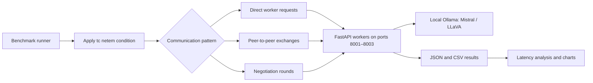

# Benchmarking Multi-Agent LLM Coordination Under Network Constraints

   

**Research question:** How do latency, jitter, packet loss and bandwidth constraints affect the responsiveness of LLM agents that coordinate through HTTP?

## Motivation and approach

Multi-agent AI applications rely on communication, not just model inference. An approach that works on a fast local network may behave differently in an edge/IoT setting with unstable connections. This project examines **how communication patterns respond to impaired networks**, so architecture choices can be informed by measured latency rather than assumptions.

Three FastAPI agent processes, each connected to a local Ollama backend, implement **direct worker requests**, **peer-to-peer conversation**, and **iterative negotiation**. Linux `tc netem` injects five loopback-network conditions while Python records completion times and message metadata.

## System workflow



Workers 1–2 use **Mistral** and worker 3 uses **LLaVA** in the checked-in code. Workers are separate local processes, **not separate machines**. The direct-request benchmark is labelled `coordinator` in its output files but **does not execute task decomposition in `agents/coordinator.py`**. Its results should therefore be interpreted as direct worker calls, not an end-to-end coordinator benchmark.

## Results

The charts below use the **checked-in CSV datasets**, not synthetic measurements. All plotted numbers are averages of recorded run times (seconds).


| Measured pattern | Baseline | IoT extreme | Slowdown |
|---|---:|---:|---:|
| Direct worker requests | 10.34 s | 10.80 s | 1.04× |
| Negotiation | 7.96 s | 82.95 s | **10.42×** |
| Peer-to-peer | 25.20 s | 71.14 s | **2.82×** |

**Answer to the research question:** In these recorded runs, the multi-round approaches incurred the largest completion-time increases under the strongest simulated network impairment, especially negotiation. The result illustrates how repeated agent communication can magnify system-level latency. It **does not establish an overall best architecture**: runs have different message counts, model assignments, and non-monotonic timing variation. Additional controlled repetitions would be needed for a causal, statistically robust comparison.

## Running the benchmarks

**Requirements:** Linux, Python 3, Ollama, `tc` from `iproute2`, and permission to run `sudo tc`. Run the benchmarks in a dedicated environment: `tc netem` changes the loopback interface and may affect other local services.

> **Portability note:** The current repository contains absolute paths in several Python files and `start_workers.sh` (originally written for EURECOM JupyterHub). The commands below are generic, but **to run the project from an arbitrary directory, those code paths must first be replaced with paths derived from the repository location**. Merely changing the README or setting `PYTHONPATH` does not fix hard-coded output and image paths. In particular, review `agents/*.py`, `benchmarks/run_*.py`, `core/logger.py`, and `start_workers.sh` before using these commands on a new machine.

### 1. Clone and install dependencies

```bash
git clone https://gitlab.eurecom.fr/Nayoneeka23/multi_agent_benchmark.git
cd multi_agent_benchmark
python3 -m venv .venv
source .venv/bin/activate
python -m pip install requests fastapi uvicorn pydantic pandas numpy matplotlib scipy seaborn streamlit plotly
```

The dependency list is inferred from source imports; there is currently no `requirements.txt`.

### 2. Start Ollama (terminal 1)

```bash
ollama serve
```

In another terminal, download the models used by the checked-in workers:

```bash
ollama pull mistral
ollama pull llava
ollama list
```

### 3. Start workers (terminal 2)

From the **repository root**, activate your environment and launch the workers without using the location-specific `start_workers.sh`:

```bash
source .venv/bin/activate
export PYTHONPATH="$PWD:$PWD/core:$PWD/agents:$PWD/benchmarks"
python agents/worker.py worker_1 8001 &
python agents/worker.py worker_2 8002 &
python agents/worker.py worker_3 8003 &
wait
```

Keep this terminal open. Workers listen on localhost ports **8001**, **8002**, and **8003**. From another terminal, check their HTTP endpoints:

```bash
curl -f http://127.0.0.1:8001/openapi.json > /dev/null
curl -f http://127.0.0.1:8002/openapi.json > /dev/null
curl -f http://127.0.0.1:8003/openapi.json > /dev/null
```

### 4. Run the benchmarks (terminal 3)

From the repository root:

```bash
source .venv/bin/activate
export PYTHONPATH="$PWD:$PWD/core:$PWD/agents:$PWD/benchmarks"

# Direct worker requests
python benchmarks/run_benchmark.py

# Negotiation
python benchmarks/run_negotiation_benchmark.py

# Peer-to-peer
python benchmarks/run_p2p_benchmark.py
```

Run these **sequentially**, not at the same time. Each runner applies the configured `tc netem` conditions, records the timings, and resets conditions between tests. The direct worker benchmark overwrites its own result files; the negotiation and P2P runners append to existing files, so archive previous outputs before rerunning if needed.

### 5. Inspect results and clean up

```bash
ls -lh benchmarks/results/
sudo tc qdisc show dev lo
sudo tc qdisc del dev lo root 2>/dev/null || true
```

Stop the worker processes with **Ctrl+C** in their terminal; if necessary, identify their process IDs before terminating them. The benchmark scripts need `sudo tc` permission; verify that the queue discipline has been cleared after an interrupted run.

## Source and limitations

- **Benchmarks:** [`benchmarks/`](benchmarks/) | **communication logic:** [`agents/`](agents/) | **analysis scripts:** [`analysis/`](analysis/) | **recorded results:** [`benchmarks/results/`](benchmarks/results/).
- Image-labelled prompts exist, but the HTTP worker endpoints in the checked-in benchmark **do not pass image data to the LLM**; do not interpret those records as verified multimodal inference.
- The P2P implementation allows up to three rounds and normally records seven conversation entries by design, not as evidence of adaptive convergence.
- Timing combines inference and communication behavior; the mixed Mistral/LLaVA configuration and noisy baselines limit direct causal attribution to the network.
- Existing analysis scripts may require repository-specific paths and dependencies. The charts in this README were generated directly from the checked-in CSV outputs.

*Academic benchmarking project, EURECOM.*
